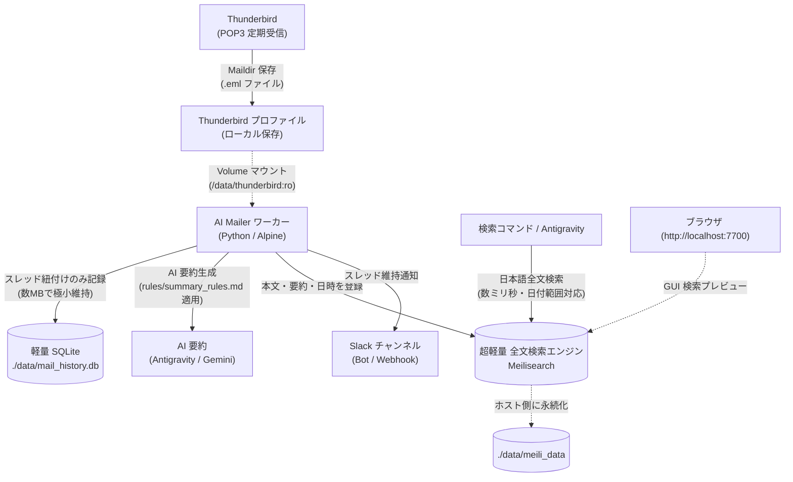

# antigravity-mail-management

<details>
<summary>目次 / 概要</summary>

- [1. 概要](#1-概要)
- [2. 主な特徴](#2-主な特徴)
- [3. アーキテクチャ](#3-アーキテクチャ)
- [4. クイックスタート](#4-クイックスタート)
- [5. 過去メールの全文検索](#5-過去メールの全文検索)
- [6. AI 要約ルールのカスタマイズ](#6-ai-要約ルールのカスタマイズ)
- [7. データ永続化とプライバシー](#7-データ永続化とプライバシー)
- [8. ロードマップ (GitHub Issues)](#8-ロードマップ-github-issues)
</details>

Thunderbird（POP3 / Maildir 形式）の新着メールを自動検知し、AI が要約して Slack に通知・スレッド維持・超高速な日本語全文検索を行う、Antigravity 向けのメール自動化・管理ツールです。

---

## 1. 概要
- **安全なローカル解析**: メールサーバーへの二重アクセスや POP3 競合リスクを排除し、Thunderbird がローカルに保存した `.eml` を安全に読み取ります。
- **軽量 Docker 構成**: Python や検索エンジン（Meilisearch）を Docker コンテナ内に完結させており、macOS と Windows の双方で同一の環境としてシームレスに動作します。
- **Antigravity 連携**: Antigravity と対話しながら、新着チェック・全文検索・要約ルールの適用が可能です。

---

## 2. 主な特徴
1. **スレッド維持通知**: メールの `In-Reply-To` / `References` を解析し、Slack 上で返信スレッドとして継続投稿。
2. **超高速な日本語全文検索**: Rust 製の超軽量全文検索エンジン「Meilisearch」を同梱。数ミリ秒で日本語の分かち書き検索・あいまい検索・日付範囲絞り込みが可能。
3. **SQLite の極小スリム化**: SQLite にはスレッド追跡と処理済みフラグ（数MB）のみを保持し、肥大化を完全防止。
4. **自然言語によるルールカスタマイズ**: `rules/summary_rules.md` に自然言語で好みを書くだけで、翻訳併記や特定差出人の重要度判定を override。

---

## 3. アーキテクチャ



---

## 4. クイックスタート

### ステップ 1: 設定ファイルの作成
```bash
cp config.example.json config.json
cp .env.example .env
```
- `.env`: ホストマシンの Thunderbird プロファイルパスを指定します。
- `config.json`: Slack の Webhook URL または Bot Token などを設定します。

### ステップ 2: 初回キャッチアップ（過去メールの一括既読化）
初回起動時、過去のメールを一括で既読登録し、Meilisearch にインデックス化します（Slack への大量誤通知はスキップされます）：
- **macOS / Linux**:
  ```bash
  ./run.sh --init-catchup
  ```
- **Windows**:
  ```cmd
  run.bat --init-catchup
  ```

### ステップ 3: 通常スキャン＆Slack 通知
- **macOS / Linux**:
  ```bash
  # テスト実行（ドライラン）
  ./run.sh --dry-run

  # 本番実行
  ./run.sh
  ```
- **Windows**:
  ```cmd
  :: テスト実行（ドライラン）
  run.bat --dry-run

  :: 本番実行
  run.bat
  ```

---

## 5. 過去メールの全文検索

Meilisearch により、日本語の形態素解析・あいまい検索・日付範囲絞り込みが数ミリ秒で動作します。

```bash
# 1. キーワード全文検索（日本語対応）
./run.sh --search "見積もり"

# 2. 日付範囲で絞り込み (2026年10月1日〜10月31日)
./run.sh --since "2026-10-01" --until "2026-10-31"

# 3. キーワード ＋ 日付範囲 ＋ 件数指定
./run.sh --search "山田" --since "2026-10-01" --limit 5
```
※ Windows の場合は `./run.sh` を `run.bat` に置き換えて実行してください。

---

## 6. AI 要約ルールのカスタマイズ

`rules/summary_rules.md` に自然言語でルールを追記することで、要約時の振る舞いを自由にカスタマイズできます：
- 英語や外国語メールの日本語訳併記
- メーリングリストや広告メールの 1 行短縮
- 請求書・見積書の金額・納期の太字抽出

---

## 7. データ永続化とプライバシー

ホスト PC 側の `./data` フォルダにのみデータが保存されます：
- `./data/mail_history.db`: スレッド追跡・重複防止用の極小 SQLite DB
- `./data/meili_data/`: Meilisearch の全文検索インデックス

`.gitignore` により、設定ファイル（`config.json`, `.env`）およびローカルデータ（`./data`）は Git にコミットされない設計になっています。

---

## 8. ロードマップ (GitHub Issues)

今後の拡張機能は GitHub Issues にて管理されています：
- **#1**: Slack からのメール返信機能 (SMTP連携 & AI下書き生成)
- **#2**: AI による要返信メールの自動検知と未対応リマインド機能
- **#3**: フィッシング詐欺・なりすまし検知スキル (認証検証 & AI怪しさ判定)
- **#4**: Thunderbird 迷惑メール（スパム）判定への登録連携
- **#5**: 休暇・不在時のインテリジェント自動返信 (AI 応答)
- **#6**: 添付ファイル抽出・ローカル保持と Antigravity プレビュー/ダウンロード機能
- **#7**: AI 要約ルールのユーザーカスタマイズ (rules/summary_rules.md)
- **#8**: Antigravity スケジューラ連携による 30分間隔の自動メール巡回
- **#9**: 配布用 AI オンボーディング (AGENTS.md / 専用スキル) & 対話型インストーラー
- **#10**: AI メモリ機能 (セッションハンドオーバー & 複数端末間コンテキスト同期)

---

## 📝 変更履歴

| 日付 | バージョン | 変更内容 |
| :--- | :--- | :--- |
| 2026-10-31 | v0.1.0 | 初期パブリックリリース（Docker, Meilisearch, SQLite, 日付範囲検索, ルールoverride対応） |
