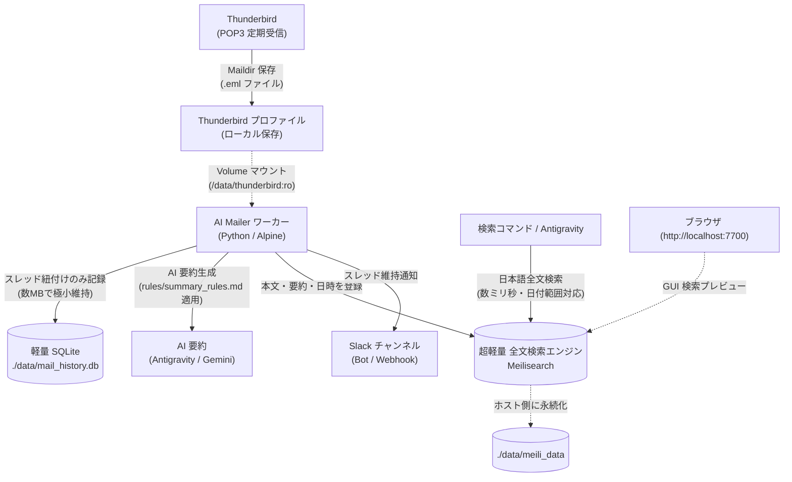

# antigravity-mail-management

<details>
<summary>目次 / 概要</summary>

- [1. 概要](#1-概要)
- [2. 主な特徴](#2-主な特徴)
- [3. 前提条件・動作要件](#3-前提条件動作要件)
- [4. アーキテクチャ](#4-アーキテクチャ)
- [5. クイックスタート](#5-クイックスタート)
- [6. 過去メールの全文検索](#6-過去メールの全文検索)
- [7. AI 要約ルールのカスタマイズ](#7-ai-要約ルールのカスタマイズ)
- [8. データ永続化とプライバシー](#8-データ永続化とプライバシー)
- [9. ロードマップ (GitHub Issues)](#9-ロードマップ-github-issues)
</details>

Thunderbird（POP3 / Maildir 形式）の新着メールを自動検知し、AI が要約して Slack に通知・スレッド維持・超高速な日本語全文検索を行う、Antigravity 向けのメール自動化・管理ツールです。

---

## 1. 概要
- **安全なローカル解析**: メールサーバーへの二重アクセスや POP3 競合リスクを排除し、Thunderbird がローカルに保存した `.eml` を安全に読み取ります。
- **軽量 Docker 構成**: Python や検索エンジン（Meilisearch）を Docker コンテナ内に完結させており、macOS と Windows の双方で同一の環境としてシームレスに動作します。
- **Antigravity 連携**: Antigravity と対話しながら、新着チェック・全文検索・要約ルールの適用が可能です。

---

## 2. 主な特徴
1. **スレッド維持通知**: メールの `In-Reply-To` / `References` を解析し、Slack 上で返信スレッドとして継続投稿。
2. **超高速な日本語全文検索**: Rust 製の超軽量全文検索エンジン「Meilisearch」を同梱。数ミリ秒で日本語の分かち書き検索・あいまい検索・日付範囲絞り込みが可能。
3. **SQLite の極小スリム化**: SQLite にはスレッド追跡と処理済みフラグ（数MB）のみを保持し、肥大化を完全防止。
4. **自然言語によるルールカスタマイズ**: `rules/summary_rules.md` に自然言語で好みを書くだけで、翻訳併記や特定差出人の重要度判定を override。

---

## 3. 前提条件・動作要件

本ツールを実行するために必要な環境は以下の通りです：

| 項目 | 要件・推奨環境 | 備考 |
| :--- | :--- | :--- |
| **OS** | macOS (Apple Silicon / Intel) または Windows 10 / 11 | Docker Desktop 稼働環境 |
| **必須ツール** | **Docker Desktop** (Docker Compose v2 対応) | コンテナ上で安全に実行 |
| **メーラー** | **Mozilla Thunderbird** (POP3 または IMAP) | ローカルにメールが保存されていること |
| **AI 実行環境** | **Google Antigravity**（推奨）<br>または Claude Code / Cursor / Windsurf / Copilot | エージェントごとの設定方法は [AI エージェント別設定ガイド](docs/agents/README.md) を参照 |
| **外部通知** | Slack ワークスペース (Incoming Webhook または Bot Token) | メール要約の受信・返信用 |
| **API キー** | Google Gemini API キー (任意) | Antigravity 連携時は不要（完全無料） |

> [!TIP]
> 各 AI エージェント（Antigravity, Claude Code, Cursor 等）の使い分けや定期実行の設定手順については、[**`docs/agents/README.md`**](docs/agents/README.md) をご覧ください。

---

## 4. アーキテクチャ



---

## 5. クイックスタート

### 🚀 対話型セットアップ（推奨）
初めて利用する場合は、対話型セットアップウィザードを実行すると、Thunderbird プロファイルの自動探索から設定ファイル生成、初回キャッチアップまでワンクリックで完了します：
- **macOS / Linux**: `./setup.sh`
- **Windows**: `setup.bat` (ダブルクリック実行可)
- **Antigravity**: チャットで「**セットアップして**」と話しかけるだけで AI が自律実行します。

---

### 手動セットアップの場合

#### ステップ 1: 設定ファイルの作成
```bash
cp config.example.json config.json
cp .env.example .env
```
- `.env`: ホストマシンの Thunderbird プロファイルパスを指定します。
- `config.json`: Slack の Webhook URL または Bot Token などを設定します。

### ステップ 2: 初回キャッチアップ（過去メールの一括既読化）
初回起動時、過去のメールを一括で既読登録し、Meilisearch にインデックス化します（Slack への大量誤通知はスキップされます）：
- **macOS / Linux**:
  ```bash
  ./run.sh --init-catchup
  ```
- **Windows**:
  ```cmd
  run.bat --init-catchup
  ```

### ステップ 3: 通常スキャン＆Slack 通知
- **macOS / Linux**:
  ```bash
  # テスト実行（ドライラン）
  ./run.sh --dry-run

  # 本番実行
  ./run.sh
  ```
- **Windows**:
  ```cmd
  :: テスト実行（ドライラン）
  run.bat --dry-run

  :: 本番実行
  run.bat
  ```

### ステップ 4: Slack 双方向対話 & ボタン操作リスナーの起動 (ポート開放不要)
Slack 側でのボタン操作（[📄 全文を展開], [✅ 既読にする], [🚫 スパムに登録]）や、スレッド内での AI 遠隔対話（返信案生成）を有効にする場合：
- **macOS / Linux**:
  ```bash
  ./run.sh --listen
  ```
- **Windows**:
  ```cmd
  run.bat --listen
  ```

### ステップ 5: 要返信メールのリマインド実行
AI が「要返信」と判定し、まだ返信対応していないメールを Slack スレッドにリマインド通知します：
- **macOS / Linux**:
  ```bash
  ./run.sh --remind
  ```
- **Windows**:
  ```cmd
  run.bat --remind
  ```

---

## 6. 過去メールの全文検索

Meilisearch により、日本語の形態素解析・あいまい検索・日付範囲絞り込みが数ミリ秒で動作します。

```bash
# 1. キーワード全文検索（日本語対応）
./run.sh --search "見積もり"

# 2. 日付範囲で絞り込み (2026年10月1日〜10月31日)
./run.sh --since "2026-10-01" --until "2026-10-31"

# 3. キーワード ＋ 日付範囲 ＋ 件数指定
./run.sh --search "山田" --since "2026-10-01" --limit 5
```
※ Windows の場合は `./run.sh` を `run.bat` に置き換えて実行してください。

---

## 7. AI 要約ルールのカスタマイズ

`rules/summary_rules.md` に自然言語でルールを追記することで、要約時の振る舞いを自由にカスタマイズできます：
- 英語や外国語メールの日本語訳併記
- メーリングリストや広告メールの 1 行短縮
- 請求書・見積書の金額・納期の太字抽出

---

## 8. データ永続化とプライバシー

ホスト PC 側の `./data` フォルダにのみデータが保存されます：
- `./data/mail_history.db`: スレッド追跡・重複防止用の極小 SQLite DB
- `./data/meili_data/`: Meilisearch の全文検索インデックス

`.gitignore` により、設定ファイル（`config.json`, `.env`）およびローカルデータ（`./data`）は Git にコミットされない設計になっています。

---

## 9. ロードマップ (GitHub Issues)

今後の拡張機能および実装ステータス：
- [x] **#1**: Slack スレッド内での Antigravity 遠隔対話機能 (スマホ遠隔対話・要約深掘り・返信案生成)
- [x] **#2**: AI による要返信メールの自動検知と未対応リマインド機能 (返信済み除外・--remind)
- [ ] **#3**: フィッシング詐欺・なりすまし検知スキル (認証検証 & AI怪しさ判定)
- [x] **#4**: Thunderbird 迷惑メール（スパム）判定への登録連携 (move_to_junk_local & ボタン連携)
- [ ] **#5**: 休暇・不在時のインテリジェント自動返信 (AI 応答)
- [x] **#6**: 添付ファイル抽出・ローカル保持と Antigravity プレビュー/ダウンロード機能 (添付保存・Block Kit表示)
- [x] **#7**: AI 要約ルールのユーザーカスタマイズ (rules/summary_rules.md 適用)
- [ ] **#8**: Antigravity スケジューラ連携による自動メール巡回
- [x] **#9**: 配布用 AI オンボーディング (Thunderbird同期間隔の自動読取 & 対話型インストーラー)
- [ ] **#10**: AI メモリ機能 (セッションハンドオーバー & 複数端末間コンテキスト同期)
- [x] **#11**: メールの引用自動除去 (Quote Strip) による要約精度向上 & トークン削減
- [x] **#12**: 過去スレッド自動遡及取り込み (古いメールの履歴展開 ＆ 最新メール未読化)
- [x] **#13**: Slack 3種ボタン & Thunderbird 既読フラグ双方向同期 ([全文を展開], [Antigravityで開く], [既読にする])
- [x] **#14**: スパムメール自動除外 & AI誤判定レスキュー通知 (スパム登録ボタン付き)
- [ ] **#15**: Thunderbird 連携によるメール送信機能 (thunderbird-cli 連携 / SMTP直接操作の回避)

---

## 📝 変更履歴

| 日付 | バージョン | 変更内容 |
| :--- | :--- | :--- |
| 2026-10-31 | v0.2.0 | Slack Socket Mode リスナー、引用自動除去、スレッド遡及、3種インタラクティブボタン＆既読双方向同期、スパムレスキュー、要返信リマインダーの一括実装 (Issues #1, #2, #4, #6, #11, #12, #13, #14) |
| 2026-10-31 | v0.1.1 | 動作要件・前提条件の追記、docs/agents/ による AI エージェント別設定ガイドの分離 |
| 2026-10-31 | v0.1.0 | 初期パブリックリリース（Docker, Meilisearch, SQLite, 日付範囲検索, ルールoverride対応） |
